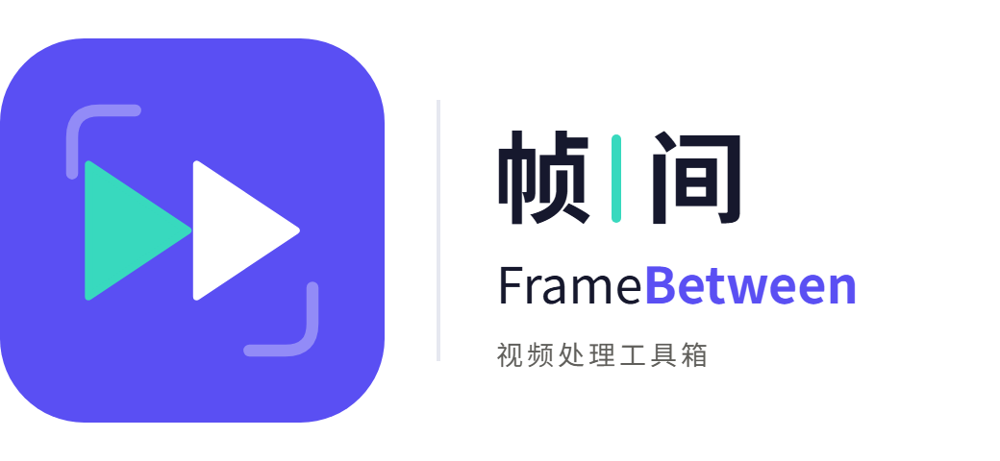

<div align="center">



# 帧间 · FrameBetween

**Desktop-grade FFmpeg command-line editing, in your pocket.**

**Everything runs locally — your media never leaves the device.**


-3DDC84)


[GitHub repository](https://github.com/Snowix/FrameBetween) ·  
[Download](#getting-started) ·  
[Features](#features) ·  
[Build from source](#building-from-source) ·  
[Privacy](#privacy-and-data) ·  
[简体中文](README.md)

> **简体中文**: 帧间是一款完全在设备本地运行的 Android 音视频处理工作台，以 FFmpeg 为引擎，可裁剪、转换、合并、加字幕与水印、转码音视频，命令行全程可见，并可选 AI 辅助。无账号、不上传、无广告。[阅读完整中文文档 →](README.md)

</div>

---

## What is FrameBetween

**FrameBetween** is a native Android audio/video workstation. Powered by **FFmpeg 9.0.2**, it turns command-line-grade editing into taps, drags and previews on a phone.

There is no account, no cloud service and no server of our own: transcoding, trimming, merging, subtitles, watermarks and GIFs are all handled by FFmpeg on the device. **The app only connects to the network when you actively use the AI assistant or tap an external link, and it sends only a short text summary of media information — never the media file itself.**

Unlike one-tap filter apps, FrameBetween keeps the command line transparent: every job shows the exact FFmpeg arguments it runs, and the FFmpeg Command Line page lets you write any arguments by hand, insert file paths, and read detailed logs, progress and failure reasons.

### Design Principles

| Principle | How |
| --- | --- |
| Local first | No account, no analytics, no ad SDKs; media is never uploaded or routed through a server |
| Transparent commands | Commands generated by every tool are visible, copyable and editable; detailed logs + progress + a three-line failure digest |
| Visual preview | Several edits can be previewed before processing; output size is estimated up front |
| AI support | Cloud or local models can assist with command input, error analysis and result evaluation |

---

**简体中文版本**: [README.md](README.md)

## Table of Contents

- [Highlights](#highlights)
- [Features](#features)
- [Getting Started](#getting-started)
- [Building from Source](#building-from-source)
- [FFmpeg Command Examples](#ffmpeg-command-examples)
- [Privacy and Data](#privacy-and-data)
- [FAQ](#faq)
- [Changelog](#changelog)
- [Contributing](#contributing)
- [License and Credits](#license-and-credits)

---

## Highlights

- **Offline by design**: FFmpeg ships as an AAR inside the app, so processing is fully offline — editing works even in airplane mode.
- **Transparent and visual**: cropping, watermarks, watermark removal, audio waveforms and speed changes all have previews, while every command is laid out in the open.
- **Broad capability**: a self-compiled FFmpeg 9.0 build with the usual libraries covers almost any audio/video task, including batch operations.
- **Optional AI add-on**: for needs the quick tools do not cover, add an API key and get help across the entire command-line workflow, with professional-grade prompts and multi-turn conversation.

---

## Features

<table align="center">
  <tr>
    <td align="center"></td>
    <td align="center"></td>
  </tr>
  <tr>
    <td align="center"></td>
    <td align="center"></td>
  </tr>
</table>

### Editing Tools

| Module | Capabilities |
| --- | --- |
| Compress / Convert | MP4 / MKV / MOV / WebM / MP3 / M4A / WAV / FLAC / OGG; H.265 (libx265) by default, switchable to H.264 / VP9; adjustable resolution, bitrate, CRF, preset and frame rate, live size estimate, batch support |
| Trim by Time | Range slider linked two-way with exact frames / fractional seconds, fast mode; draggable playback bar below the preview |
| Crop Frame | Drag a selection on the preview (corner resize, whole-area pan, live pixel coordinates) |
| Delete Frames | Delete ranges by frame number (multiple ranges merge automatically); **Precise · Re-encode** (`select` + `setpts` with `aselect` + `asetpts` for A/V sync) or **Fast · Stream copy** (concat demuxer + `-c copy`) |
| Speed | 0.25–4.00×, `setpts` + `atempo` (two stages chained automatically above 2×), shows the expected output duration |
| Merge Videos | Multi-select concatenation with reordering; files can be filled in directly from another app's Share action |
| Flip & Mirror | Horizontal / vertical flip, rotation, and a fast mode that only changes the rotation metadata |
| Video to GIF | Two-pass `palettegen` / `paletteuse` optimisation with adjustable frame rate, size and time range |
| Mute / Extract Audio | Losslessly remove the audio track, or export to MP3 / M4A / WAV / FLAC / OGG |
| Audio Join | Preview each segment, sequential join / track mixing, per-track volume, crossfade |
| Audio Cut | `showwavespic` waveform with highlighted range; dragging the range moves the playback position, 0.5–4.0× speed preview |
| Subtitles & Watermarks | Extract / mux / burn in subtitles (SRT / VTT / ASS / SSA parsed and rendered line by line for CJK text, with libass fallback for very long lines); text and image watermarks can be dragged, pinch-zoomed and configured for font colour, opacity, time range, random appearance and edge bouncing; watermark removal offers a visual selection box with blur / mosaic / smart fill (delogo) |

### Command Line, AI and Tasks

| Module | Capabilities |
| --- | --- |
| FFmpeg Command Line | Run arguments directly, quick templates, insert paths, command history, live logs, stop, Ask AI |
| Ask AI | Injects real ffprobe measurements for the current file and produces a final command marked with `{ffmpeg命令}` plus a safer alternative; supports **prompt off** (send as-is) and **multi-turn conversation** (stored on device) |
| AI Diagnosis | On failure, sends the failure reason, error message and a **redacted command** to the model to pinpoint the problem |
| AI Result Review | On completion, compares input / output ffprobe data, the editing request and the redacted command, then judges whether the goal was met and suggests improvements and commands |
| Task Queue | Foreground service, progress / speed, cancel, logs, open, share, save as |

### Media Library & File Management

- **Audio and video only**: `MediaStore.Video` / `MediaStore.Audio` with a `Files` fallback (filtered by `video/*`, `audio/*`), so photos never leak into the media list.
- **Three views × two layouts**: folders / tree / files, as a list or a 2–3 column grid; folder and tree views support **nested folders** that expand along the real directory hierarchy with breadcrumb navigation.
- **Hidden folders and `.nomedia`**: recursively hide directories, toggle `.nomedia`; when disabled, the app walks up the real path looking for markers and re-filters published lists / disk snapshots / reused results consistently.
- **All Files**: a switch next to the title browses the phone's real directories level by level, with search, sorting and the system Open with action.

### Settings

The home screen holds theme (light / dark / follow system), interface language, default output folder, folder allow/deny lists and scan paths, AI provider configuration (OpenAI-compatible endpoints, including local Ollama / LM Studio models), Advanced and About, plus the logo at the top.

- **Advanced**: permission status, device codec support, backup and restore (export XML to a chosen folder / import from the system file picker), with the Logs group at the bottom.
- **Detailed Logs**: an Enable Logs switch at the top, **off by default** — when off, nothing is written to memory or disk. Once on, Live Logs can be viewed and auto-refreshed by level (verbose / debug / info / warning / error), and Export Logs can **share / export / clear** by category, asking for the category and destination folder first. Logs are generated on the device only and never uploaded.
- **About**: app introduction, privacy policy, third-party libraries and more.

---

## Getting Started

### Install

1. Download the APK from [Releases](https://github.com/Snowix/FrameBetween/releases), or build it yourself using the steps below.
2. Copy it to your phone and tap to install (Android 8.0+ / **64-bit arm64-v8a only**). You can also install from a terminal:
   ```bash
   adb install -r FrameBetween-1.0.0-arm64-v8a-release.apk
   ```
3. On first opening the Media Library, grant media read access. To read and write arbitrary directories or browse hidden / `.nomedia` folders, enable All Files Access under Settings → Advanced & About → Advanced → Permissions.

### Your First Edit

```
Home → pick a tool (for example "Compress / Convert")
     → tap "Current file" and choose a video
     → adjust the parameters and check the preview
     → tap Run and follow progress and logs on the Tasks page
     → Open / Share / Save as when it finishes
```

Output goes to `Android/data/com.framebetween.app/files/Movies/FrameBetween/` by default, named "original name + MMddHHmmss timestamp".

---

## Building from Source

### Requirements

| Item | Requirement |
| --- | --- |
| JDK | **17** |
| Build tools | Android Gradle Plugin 8.7.3, Gradle 8.9, Kotlin 2.0.21 |
| Android SDK | Platform 35, Build-Tools 35.0.0 or newer |
| Android Studio | Optional — open the project root and wait for Sync |

Main dependencies: Jetpack Compose BOM 2024.12.01 / Material 3, Navigation Compose 2.8.5, Media3 ExoPlayer 1.5.1, DocumentFile 1.0.1, kotlinx-coroutines 1.9.0.

## FFmpeg Command Examples

Paste these straight into the FFmpeg Command Line page (Insert Path replaces `{in}` / `{out}` with the real files for the current job):

```bash
# H.265 compression with AAC audio
-y -i {in} -c:v libx265 -crf 28 -preset medium -c:a aac -b:a 128k {out}

# 1.5x speed with audio/video sync
-y -i {in} -filter_complex "[0:v]setpts=PTS/1.5[v];[0:a]atempo=1.5[a]" -map "[v]" -map "[a]" {out}

# Horizontal mirror + vertical flip
-y -i {in} -vf "hflip,vflip" -c:a copy {out}

# Native drawtext CJK overlay (since 9.0.2 it is no longer rewritten as ASS)
-y -i {in} -vf "format=yuv420p,drawtext=fontfile=/system/fonts/NotoSansCJK-Regular.ttc:text='帧间':fontsize=h/22:fontcolor=white:borderw=2:bordercolor=black:x=(w-text_w)/2:y=h-text_h-h*0.06" {out}

# Two-pass GIF (generate the palette first)
-y -i {in} -vf "fps=12,scale=480:-1:flags=lanczos,palettegen" palette.png
-y -i {in} -i palette.png -filter_complex "fps=12,scale=480:-1:flags=lanczos[x];[x][1:v]paletteuse" {out}
```

## Privacy and Data

- No names, email addresses, device identifiers, location, contacts, clipboard contents or usage behaviour are collected; no analytics, advertising or crash-reporting SDKs are included.
- Media files are read directly by their real path whenever possible; a temporary copy in the app cache is created only when a content provider cannot give a readable path, and it is reclaimed as soon as you switch files or restart the app.
- Settings, language, view preferences, folder authorisations and conversation history stay on the device; clearing the cache or uninstalling removes them.
- Detailed Logs are off by default and, when enabled, write only to the local `filesDir/logs/` — never uploaded.
- `INTERNET` is used only for Ask AI, AI Diagnosis, AI Result Review, listing models, testing a connection and links you tap yourself; the app never connects in the background.

The full policy is available in-app at Settings → Advanced & About → About → Version & Introduction → Privacy Policy.

---

## FAQ

**Q: My files don't show up in the Media Library.**  
A: Check that media read / All Files Access is granted under Settings → Advanced & About → Advanced → Permissions. In Folder Settings, make sure the directory is not excluded by the deny list or a `.nomedia` rule, and tap Rescan.

**Q: Why aren't my photos in the Media Library?**  
A: The library only indexes audio and video. Use All Files next to the title to browse images and documents.

**Q: Will AI upload my video?**  
A: No. Only an ffprobe text summary, your question and a redacted command are sent; media files and device information are never sent. Without AI features the app does not use the network at all.

**Q: Some videos fail to play with "ERROR_CODE_IO_UNSPECIFIED".**  
A: The app uses ExoPlayer, which does not support every codec, and it does not transcode automatically — convert the file first. To see the exact cause, go to Settings → Advanced & About → Advanced → Logs → Detailed Logs, **turn on Enable Logs first**, reproduce the problem once, then use Export Logs.

**Q: Where are my output files?**  
A: In `Android/data/com.framebetween.app/files/Movies/FrameBetween/` by default; you can change it to the system media library or a custom folder in Settings.

**Q: Is there a 32-bit, iOS or desktop version?**  
A: Currently Android arm64-v8a only, with no plans for other platforms.

---

## Changelog

### 1.0.0 (2026-11-15)

First official release: the "FrameBetween" name, the `com.framebetween.app` package, the FFmpeg 9.0.2 engine and the full set of local editing tools.

---

## Contributing

Bug reports and suggestions are welcome in [Issues](https://github.com/Snowix/FrameBetween/issues), and so are pull requests:

1. Fork the repository and create a branch;
2. After your changes, run `./gradlew :app:testDebugUnitTest`, `python scripts/selfcheck.py` and `python scripts/i18n.py apply`;
3. For new UI strings, add the English counterpart in `scripts/i18n_en.json`;
4. Open a PR describing the motivation and how you verified it.

Follow the official Kotlin style conventions; the UI uses Jetpack Compose + Material 3 with **global instant, animation-free navigation**.

---

## License and Credits

This project bundles a self-compiled FFmpeg 9.0.2 AAR (built with `--enable-gpl` and libx264 / libx265 / libmp3lame), and is therefore licensed **GPL-3.0-or-later**; review the licensing implications before any closed-source commercial distribution. Fonts and third-party components remain under their respective owners' licenses.

Thanks to:

- [FFmpeg](https://ffmpeg.org/) and [ffmpeg-kit-next](https://github.com/arthenica/ffmpeg-kit-next) (v9.0.2 sources, compiled into an AAR)
- [Jetpack Compose](https://developer.android.com/jetpack/compose) / Material 3 / [Media3 ExoPlayer](https://developer.android.com/media/media3)
- Everyone who reported issues and tested on real devices

---

<div align="center">

**FrameBetween · Process locally, never upload your files**

<https://github.com/Snowix/FrameBetween>

</div>
