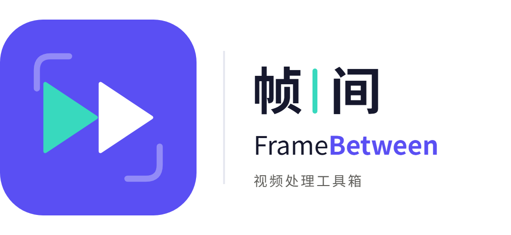

<div align="center">



# 帧间 · FrameBetween

**把桌面级的 FFmpeg 命令行剪辑能力装进手机。**

**完全本地处理，媒体文件从不离开你的设备。**

 -3DDC84)    

🌐 [简体中文](README.md)|[English](README.en.md)

[GitHub 仓库](https://github.com/Snowix/FrameBetween) · [下载安装](#快速开始) · [功能一览](#功能一览) · [从源码构建](#从源码构建) · [隐私与数据](#隐私与数据)

> **English**: FrameBetween is an offline Android FFmpeg workstation — trim, convert, merge, subtitle, watermark and transcode video/audio on-device, with a visible command line and optional AI assistance. No account, no upload, no ads.

</div>

---

## 这是什么

**帧间（FrameBetween）** 是一款 Android 原生音视频处理工作台。它以 **FFmpeg 9.0.2** 为引擎，把命令行级的剪辑能力做成手机上可点、可拖、可预览的操作。

本应用没有账号、没有云端服务、没有自有服务器：转码、裁剪、合并、字幕、水印、GIF 全部在设备本地由 FFmpeg 完成。**只有你主动使用 AI 助手或点击外部链接时才会联网，而且只发送部分媒体信息文本摘要，不发送媒体文件本身。**

与「一键滤镜」类应用不同，帧间保留命令行的透明度：每一项处理都能看到真正执行的 FFmpeg 参数，也能直接在【FFmpeg 命令行】页手写任意参数、插入路径、查看详细日志、进度与失败原因。

### 设计原则

| 原则   | 具体做法                                      |
| ---- | ----------------------------------------- |
| 本地优先 | 无账号、无统计、无广告 SDK；媒体文件不上传、不经过任何服务器          |
| 命令透明 | 所有工具页生成的命令可见、可复制、可改写；详细日志 + 进度 + 失败末尾三行摘要 |
| 可视预览 | 部分编辑可提前在处理页面预览效果；生成文件大小提前预估               |
| AI支持 | 支持使用云端及本地模型，在命令输入、错误解析、效果评估阶段寻求AI支持       |

---

## 目录

- [亮点](#亮点)
- [功能一览](#功能一览)
- [快速开始](#快速开始)
- [从源码构建](#从源码构建)
- [FFmpeg 命令行示例](#ffmpeg-命令行示例)
- [隐私与数据](#隐私与数据)
- [常见问题](#常见问题)
- [更新日志](#更新日志)
- [参与贡献](#参与贡献)
- [许可证与致谢](#许可证与致谢)

---

## 亮点

- **本地离线**：FFmpeg 以 AAR 形式随包安装，处理过程完全离线，飞行模式下也能剪辑。
- **透明可视化**：裁剪、水印、去水印、音频波形、变速都有可预览，同时每条命令都摊开给你看。
- **功能强大**：集成自编译 FFmpeg 9.0 版本和常用依赖，支持几乎所有音视频处理要求，同时支持批量操作。
- **AI 外挂**：对于快捷工具中没有的复杂需求，可以在填写API后在命令行全流程寻求AI帮助，采用专业级提示词并具备连续对话功能。

---

## 功能一览

<table align="center">  
  <tr>  
    <td align="center"></td>  
    <td align="center"></td>  
  </tr>  
  <tr>  
    <td align="center"></td>  
    <td align="center"></td>  
  </tr>  
</table>

### 编辑工具

| 模块        | 能力                                                                                                                                            |
| --------- | --------------------------------------------------------------------------------------------------------------------------------------------- |
| 压缩 / 格式转换 | MP4 / MKV / MOV / WebM / MP3 / M4A / WAV / FLAC / OGG；默认 H.265（libx265），可切 H.264 / VP9；分辨率、码率、CRF、preset、帧率可调，实时体积预估，支持批量                     |
| 时长裁剪      | 区间滑条 + 精确帧 / 小数秒双向联动、极速模式；预览底部可拖动播放条                                                                                                          |
| 画面裁剪      | 在预览上拖拽选区（四角缩放、整体平移、实时像素坐标）                                                                                                                    |
| 删除帧       | 按帧号删除区间（多段自动合并）；**精确 · 重编码**（`select` + `setpts` 与 `aselect` + `asetpts` 音画同步）或 **极速 · 码流级**（concat demuxer + `-c copy`）                      |
| 视频变速      | 0.25–4.00×，`setpts` + `atempo`（>2× 自动串联两级），显示预计输出时长                                                                                           |
| 视频合并      | 多选拼接、顺序调整，支持从其他应用「分享」直接填入                                                                                                                     |
| 翻转与镜像     | 水平 / 垂直翻转、旋转，可仅修改旋转元数据极速抓转换                                                                                                                   |
| 视频转 GIF   | `palettegen` / `paletteuse` 两遍优化，帧率、尺寸、时间区间可调                                                                                                 |
| 消音 / 音频提取 | 无损移除音轨，或导出为 MP3 / M4A / WAV / FLAC / OGG                                                                                                      |
| 音频拼接      | 逐段试听、顺序拼接 / 音轨合并、逐轨音量、交叉淡化                                                                                                                    |
| 音频剪切      | `showwavespic` 波形 + 区间高亮，拖动区间同步定位试听，0.5–4.0× 变速预览                                                                                             |
| 字幕和水印     | 字幕提取 / 嵌入 / 烧录（解析 SRT / VTT / ASS / SSA 逐条渲染中文，超长字幕回落 libass）；文字与图片水印可拖动定位、双指缩放、设置字体颜色、透明度、时间段、随机显示与边缘反弹；去水印提供可视化选框 + 模糊 / 马赛克 / 智能填补（delogo） |

### 命令行、AI 与任务

| 模块         | 能力                                                                                 |
| ---------- | ---------------------------------------------------------------------------------- |
| FFmpeg 命令行 | 直接执行参数、快捷模板、快速插入路径、命令历史、实时日志、停止、求助 AI                                              |
| 求助 AI      | 注入当前文件 ffprobe 实测参数，生成带 `{ffmpeg命令}` 标记的最终命令与风险备选；支持**关闭提示词**（原样发送）与**连续对话**（本机保存） |
| AI 解析      | 执行失败时，把失败原因、报错提示、**脱敏命令**发给模型定位问题                                                  |
| AI效果评估     | 处理完成时，对比输入 / 输出的 ffprobe 信息、剪辑要求与脱敏命令，评估是否达成目标并给出改进方法和命令建议                         |
| 任务队列       | 前台服务保活、进度 / 速度、取消、日志、打开、分享、另存                                                      |

### 媒体库与文件管理

- **只收录音视频**：`MediaStore.Video` / `MediaStore.Audio` + `Files` 兜底（按 `video/*`、`audio/*` 过滤），不会把相册照片混进媒体列表。
- **三视图 × 两布局**：文件夹 / 树形 / 文件，列表或 2–3 列网格；文件夹 / 树形可选 **嵌套文件夹**，按真实目录层级逐级展开、面包屑返回。
- **隐藏与 `.nomedia`**：递归隐藏目录、`.nomedia` 开关；关闭后按真实路径向上查标记，并对已发布列表 / 磁盘快照 / 沿用结果统一重筛。
- **全部文件**：标题旁切换，直接按真实目录逐层浏览手机文件，支持搜索、排序、系统「打开方式」。

### 设置

主页包含主题样式（日/夜/跟随系统）、界面语言、默认输出目录、文件夹黑白名单与扫描路径、AI 提供商配置（OpenAI 兼容端点，含 Ollama / LM Studio 本地模型）、高级与关于，以及顶部LOGO。

- **【高级】**：权限状态、设备编解码器支持、备份与恢复（XML 导出到所选文件夹 / 从系统文件选择器导入恢复），最下方是【日志】分组。
- **【详细日志】**：顶部有【开启日志】开关，**默认关闭**——关闭时既不写内存也不落盘；开启后【实时日志】可按「详细 / 调试 / 信息 / 警告 / 错误」分级查看并自动刷新，【导出日志】可按类别**分享 / 导出 / 清空**，导出时先选类别再选保存文件夹。日志只在本机生成，绝不上传。
- **【关于】**：包含应用简介 、隐私政策、依赖库等。

---

## 快速开始

### 安装

1. 从 [Releases](https://github.com/Snowix/FrameBetween/releases) 下载，或按下方步骤自行构建。
2. 传到手机后点击安装（Android 8.0+ / **仅 64 位 arm64-v8a**）。也可命令行安装：
   ```bash
   adb install -r FrameBetween-1.0.0-arm64-v8a-release.apk
   ```
3. 首次进入【媒体库】按提示授予媒体读取权限；如需读写任意目录、浏览隐藏 / `.nomedia` 文件夹，请到【设置 → 高级与关于 → 高级 → 权限】开启「所有文件访问权限」。

### 第一次剪辑

```
首页 → 选一个工具（例如「压缩 / 格式转换」）
     → 点击「当前文件」选择视频
     → 调整参数，预览确认
     → 点击执行，在「任务」页看进度与日志
     → 完成后「打开 / 分享 / 另存」
```

产物默认写到 `Android/data/com.framebetween.app/files/Movies/FrameBetween/`，文件名为「原文件名 + MMddHHmmss 时间戳」。

---

## 从源码构建

### 环境

| 项              | 要求                                                   |
| -------------- | ---------------------------------------------------- |
| JDK            | **17**                                               |
| 构建工具           | Android Gradle Plugin 8.7.3、Gradle 8.9、Kotlin 2.0.21 |
| Android SDK    | Platform 35、Build-Tools 35.0.0 或更高                   |
| Android Studio | 可选，直接打开工程根目录等待 Sync                                  |

主要依赖：Jetpack Compose BOM 2024.12.01 / Material 3、Navigation Compose 2.8.5、Media3 ExoPlayer 1.5.1、DocumentFile 1.0.1、kotlinx-coroutines 1.9.0。

## FFmpeg 命令行示例

在【FFmpeg 命令行】页可直接粘贴（页内「插入路径」会把 `{in}` / `{out}` 换成本次真实文件）：

```bash
# H.265 压缩，音频转 AAC
-y -i {in} -c:v libx265 -crf 28 -preset medium -c:a aac -b:a 128k {out}

# 1.5 倍变速，音视频同步
-y -i {in} -filter_complex "[0:v]setpts=PTS/1.5[v];[0:a]atempo=1.5[a]" -map "[v]" -map "[a]" {out}

# 画面水平镜像 + 垂直翻转
-y -i {in} -vf "hflip,vflip" -c:a copy {out}

# 原生 drawtext 中文叠加（9.0.2 起不再改写成 ASS）
-y -i {in} -vf "format=yuv420p,drawtext=fontfile=/system/fonts/NotoSansCJK-Regular.ttc:text='帧间':fontsize=h/22:fontcolor=white:borderw=2:bordercolor=black:x=(w-text_w)/2:y=h-text_h-h*0.06" {out}

# 两遍 GIF（先生成调色板）
-y -i {in} -vf "fps=12,scale=480:-1:flags=lanczos,palettegen" palette.png
-y -i {in} -i palette.png -filter_complex "fps=12,scale=480:-1:flags=lanczos[x];[x][1:v]paletteuse" {out}
```

## 隐私与数据

- 不收集姓名、邮箱、设备标识符、位置、通讯录、剪贴板或使用行为；不内置统计 / 广告 / 崩溃上报 SDK。
- 媒体文件优先按真实路径直接读取；仅在内容提供者无法给出可读路径时，于应用 cache 创建临时副本，切换文件或冷启动即回收。
- 设置、语言、视图偏好、文件夹授权与连续对话记录只保存在本机；清缓存 / 卸载即可删除。
- 【详细日志】默认关闭，开启后也只写入本机 `filesDir/logs/`，不上传。
- `INTERNET` 仅用于求助 AI、AI 解析、AI效果评估、查询模型、测试连接与你主动点击的链接；应用不会后台自动联网。

完整条款见应用内【设置 → 高级与关于 → 关于 → 版本与简介 → 隐私政策】。

---

## 常见问题

**Q：媒体库里找不到我的文件？**  
A：检查【设置 → 高级与关于 → 高级 → 权限】是否授予媒体读取 / 所有文件访问权限；在【文件夹设置】里确认该目录未被黑名单或 `.nomedia` 规则过滤，并可点「重新扫描」。

**Q：为什么相册照片不在媒体库？**  
A：媒体库只收录音视频。浏览图片、文档请点标题旁的【全部文件】。

**Q：AI 会把我的视频传走吗？**  
A：不会。只发送 ffprobe 文本摘要、你的问题文本与脱敏命令；媒体文件与设备信息不发送。不使用 AI 功能时应用完全不联网。

**Q：有视频点开报「播放失败：ERROR_CODE_IO_UNSPECIFIED」？**  
A：本软件采用ExoPlayer，部分编码格式未兼容，且不自动转码，可先转码后使用。若需要查看具体原因，到【设置 → 高级与关于 → 高级 → 日志 → 详细日志】**先打开【开启日志】开关**，复现一次后再用【导出日志】查看。

**Q：输出文件在哪里？**  
A：默认在 `Android/data/com.framebetween.app/files/Movies/FrameBetween/`，也可在设置里改为系统媒体库或自定义目录。

**Q：支持 32 位手机 / iOS / 桌面端吗？**  
A：目前仅 Android arm64-v8a，暂无其他平台计划。

---

## 更新日志

### 1.0.0（2026-11-15）

首个正式版本：命名「帧间 / FrameBetween」、包名 `com.framebetween.app`、FFmpeg 9.0.2 内核与全套本地剪辑工具。

---

## 参与贡献

欢迎提交 [Issue](https://github.com/Snowix/FrameBetween/issues) 反馈问题或建议，也欢迎 PR：

1. Fork 仓库并创建分支；
2. 改动后跑 `./gradlew :app:testDebugUnitTest`、`python scripts/selfcheck.py`、`python scripts/i18n.py apply`；
3. 新增界面文案请同时补 `scripts/i18n_en.json` 的英文对照；
4. 提交 PR，说明改动动机与验证结果。

代码风格遵循 Kotlin 官方约定；UI 使用 Jetpack Compose + Material 3，**保持全局无动画即时切换**。

---

## 许可证与致谢

本项目内置自行编译的 FFmpeg 9.0.2 AAR（启用 `--enable-gpl` 与 libx264 / libx265 / libmp3lame），因此以 **GPL-3.0-or-later** 授权；闭源商业分发请先评估授权。字体与第三方组件许可证归各自权利人所有。

感谢：

- [FFmpeg](https://ffmpeg.org/) 与 [ffmpeg-kit-next](https://github.com/arthenica/ffmpeg-kit-next)（v9.0.2 源码，自行编译为 AAR）
- [Jetpack Compose](https://developer.android.com/jetpack/compose) / Material 3 / [Media3 ExoPlayer](https://developer.android.com/media/media3)
- 所有提交反馈与测试的设备使用者

---

<div align="center">

**帧间 FrameBetween · 本地处理，不上传文件**

<https://github.com/Snowix/FrameBetween>


</div>
